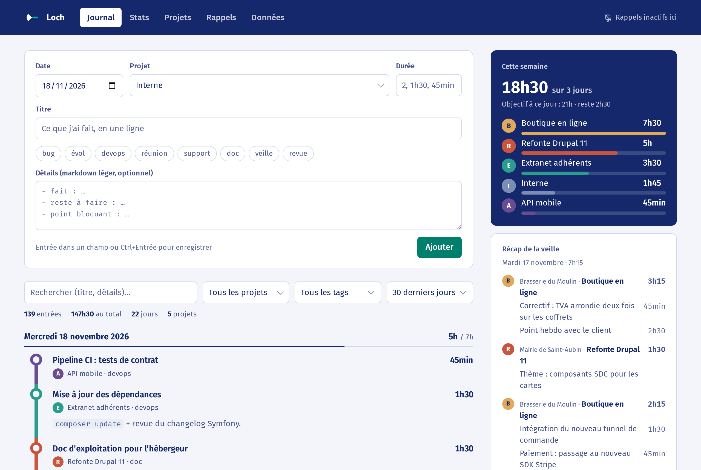
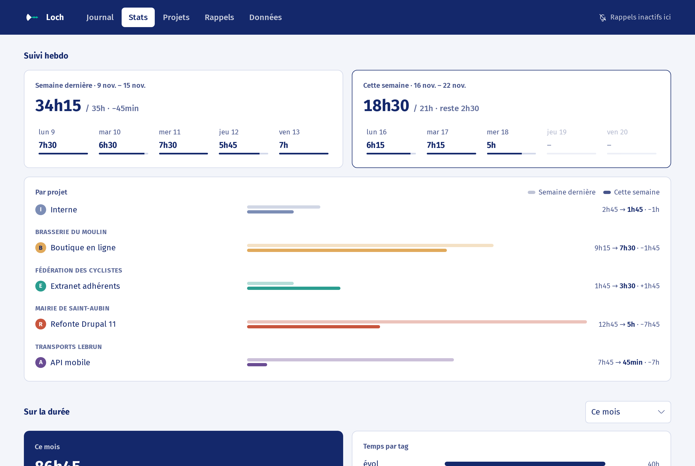
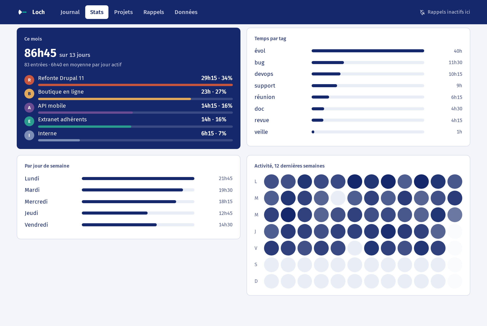
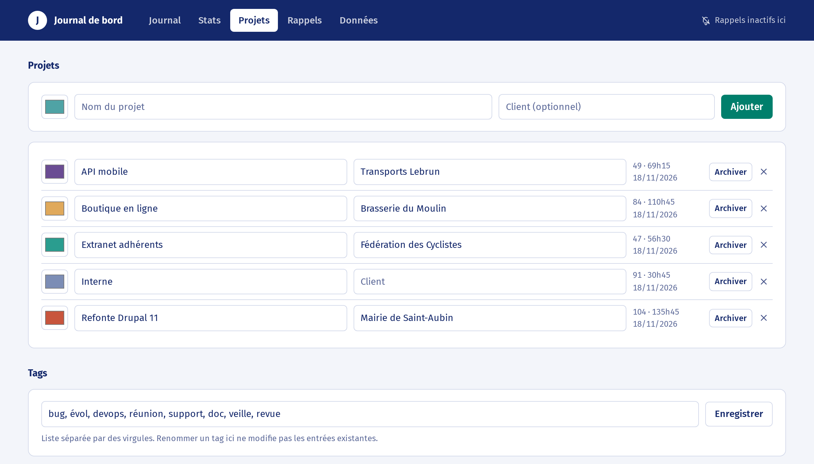
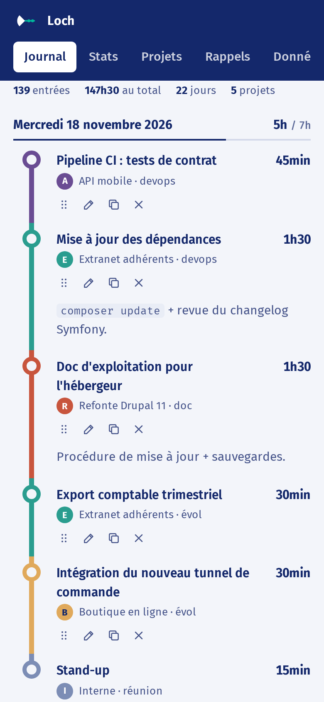

# Loch

**Le journal de bord de tes journées de travail : note ta route, relis ton sillage.**

Auto-hébergé : tu notes en quelques secondes ce que tu viens de
faire, tu relis ta veille le matin et tu vois où part ton temps, projet par projet.

PHP 8.1+ et SQLite, sans Composer, sans build, sans framework JS : une page `index.html`,
une API PHP et un cron. Interface en français, pensée pour un seul utilisateur.



## Fonctionnalités

- **Saisie rapide** : date, projet, durée, titre, tags et détails en Markdown, enregistrement
  avec Entrée / Ctrl+Entrée. Les entrées d'une journée se réordonnent par glisser-déposer.
- **Récap de la veille** en tête du journal, une ligne par projet (détail dépliable), pour le point du matin.
- **À faire** : un pense-bête pour aujourd'hui, demain ou la semaine ; ce qui n'est pas fait remonte tout seul, et une tâche cochée peut devenir une entrée en un clic.
- **Stats** : semaine en cours comparée à la précédente, temps par projet, par tag, par jour
  de semaine, activité des 12 dernières semaines, objectif journalier indicatif.
- **Projets et tags** : une couleur par projet, un client facultatif, des tags libres.
- **Rappels par Web Push**, même sans onglet ouvert, avec une pause s'il y a eu une saisie récente.
- **Données** : export et import `.sqlite`, export CSV, console SQL en lecture seule,
  sauvegarde automatique avant chaque import.

## Captures

| Suivi hebdo | Sur la durée |
|---|---|
|  |  |

| Projets et tags | Sur mobile |
|---|---|
|  |  |

Les données affichées sont fictives.

## Essayer en local

```bash
git clone https://github.com/Haza/loch.git && cd loch
cp config.example.php config.php
php -r "echo password_hash('mon-mot-de-passe', PASSWORD_DEFAULT), PHP_EOL;"
# coller le hash dans 'password_hash' de config.php
php -S localhost:8000
```

Puis ouvrir <http://localhost:8000>. La base SQLite est créée automatiquement dans `data/`.
Le Web Push fonctionne aussi sur `localhost` (contexte sécurisé) : active les rappels dans
l'onglet Rappels, puis `php cron.php --test` envoie une notification de test. En usage normal,
`cron.php` est lancé chaque minute par le cron (voir plus bas).

## Fichiers

| Fichier | Rôle |
|---|---|
| `index.html` | Interface (journal et récap de la veille, stats, projets, rappels, données) |
| `api.php` | API JSON : auth, CRUD, stats, exports, import, abonnements push |
| `inc.php` | Socle commun : base SQLite, réglages, Web Push natif (VAPID + chiffrement) |
| `cron.php` | Envoie les rappels, à lancer chaque minute en CLI |
| `config.php` | (à créer depuis `config.example.php`, non versionné) Mot de passe, chemin de la base, fuseau, journée type (`day_minutes`), contact VAPID |
| `sw.js` | Service worker : reçoit les push, gère le clic sur la notification |
| `icon.svg` | Favicon et icône des notifications |
| `.htaccess`, `data/.htaccess` | Bloquent l'accès à `config.php`, `inc.php`, `cron.php` et `data/` (Apache) |

Extensions PHP nécessaires : `pdo_sqlite`, `openssl`, `curl`, `mbstring` (présentes partout ou presque).

## Installation sur un serveur

1. Copier le dossier sur le serveur (ex : `/var/www/loch`).
2. Copier `config.example.php` en `config.php`, générer le hash du mot de passe et le coller dans `config.php` :
   ```bash
   php -r "echo password_hash('mon-mot-de-passe', PASSWORD_DEFAULT), PHP_EOL;"
   ```
3. Mettre ton adresse dans `vapid_subject` (`config.php`), ex : `mailto:moi@domaine.fr`.
4. Donner l'écriture au serveur web sur `data/` (ou sur le dossier choisi dans `db_path`) :
   ```bash
   chown -R www-data:www-data data && chmod 700 data
   ```
5. Ajouter le cron, **avec le même utilisateur que PHP web** (sinon droits sur la base) :
   ```bash
   sudo crontab -u www-data -e
   ```
   ```cron
   * * * * * php /var/www/loch/cron.php
   ```
6. Servir en **HTTPS** (obligatoire pour le Web Push).
7. Se connecter, onglet **Rappels** > « Recevoir les rappels ici », puis « Tester ».

Recommandé : mettre `db_path`, `backup_dir` et `session_dir` hors de la racine web.

### Nginx

Les `.htaccess` ne sont pas lus, ajouter :

```nginx
location ~ ^/loch/(config|inc|cron)\.php$ { deny all; }
location ~ ^/loch/(README\.md|PRODUCT\.md|LICENSE)$ { deny all; }
location ^~ /loch/data/ { deny all; }
location = /loch/sw.js { add_header Cache-Control "no-store"; }
```

## Rappels (Web Push)

Fonctionnement : le cron regarde chaque minute si un rappel est dû, puis le serveur envoie
un message chiffré au service de push du navigateur (Google pour Chrome/Vivaldi/Edge,
Mozilla pour Firefox, Apple pour Safari). Le navigateur réveille le service worker, qui
affiche la notification. **Aucun onglet n'a besoin d'être ouvert**, il suffit que le
navigateur tourne (même réduit). Sur Android, ça marche aussi navigateur fermé.

- Rappels réglables dans l'onglet Rappels : heure, jours, message, actif ou non.
- Option « ne pas rappeler si une entrée a été saisie il y a moins de N minutes ».
- Un rappel manqué (cron en retard, serveur redémarré) part encore pendant 10 minutes.
- Un seul envoi par rappel et par jour, même si deux crons se chevauchent.
- Les abonnements expirés sont supprimés automatiquement.
- L'onglet Rappels affiche l'état du cron, les appareils abonnés et les derniers envois.

### VAPID, c'est quoi ?

Une paire de clés qui identifie ton serveur auprès des services de push : la clé publique
est donnée au navigateur lors de l'abonnement, la clé privée signe chaque envoi. Ainsi,
seul ton serveur peut envoyer des notifications à tes abonnements.

**Tu n'as rien à faire** : les clés sont générées automatiquement au premier usage et
stockées dans la base (table `meta`, clé `vapid`). Elles sont conservées lors d'un import
de base. Si tu les supprimes, il suffit de recliquer « Recevoir les rappels ici » sur
chaque appareil (fait aussi automatiquement au prochain chargement de la page).

### Tester depuis le serveur

```bash
sudo -u www-data php /var/www/loch/cron.php --test   # envoie un push à tous les appareils
sudo -u www-data php /var/www/loch/cron.php -v       # affiche ce que le cron décide
```

### Dépannage

- « Le cron n'a jamais tourné » : la crontab n'est pas en place ou tourne avec un autre utilisateur.
- Rien ne s'affiche mais l'envoi est OK : vérifier les notifications du site dans le navigateur
  et celles du système (mode Ne pas déranger, réglages de notifications de Windows/macOS).
- Vivaldi : l'économiseur de mémoire n'a plus d'effet, ce n'est plus l'onglet qui envoie.
- iPhone : le Web Push ne marche que si le site est ajouté à l'écran d'accueil (iOS 16.4+).

## Sécurité

- Mot de passe unique (hash dans `config.php`), session longue (`session_days`, 365 jours par défaut), cookie `HttpOnly` + `SameSite=Strict`.
- Jeton CSRF sur toutes les écritures.
- `cron.php` refuse de s'exécuter hors CLI.
- Console SQL en lecture seule (`SELECT` / `WITH` + `PRAGMA query_only`).
- Sauvegarde automatique dans `backup_dir` avant chaque import ou réinitialisation.

## Sauvegarde cron (optionnel)

```cron
15 3 * * * sqlite3 /chemin/data/journal.sqlite ".backup '/chemin/backups/journal-$(date +\%F).sqlite'"
```

## Licence

[MIT](LICENSE)
